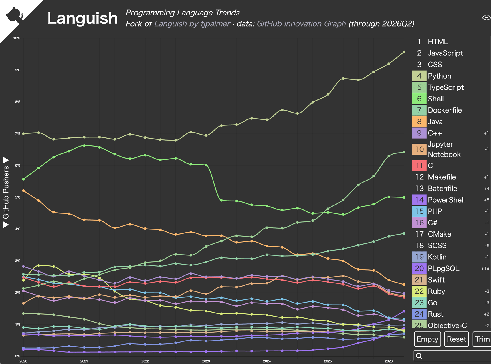

# Languish &mdash; Programming Language Trends

> "…the game of basketball evolves, and the game of basketball changes, and you have to be able to see the table turn, and you have to be able to evolve with it…"
> — LeBron James, *Mind the Game* podcast (2026)

**Live site:** https://thanks2music.github.io/languish/

Like [npm trends](https://npmtrends.com/), but for programming languages. Pick a few languages, stack their lines, and see who is rising and who is quietly packing up.



This is a fork of [tjpalmer/languish](https://github.com/tjpalmer/languish). The original stopped at 2025Q2 when its data sources ran dry, so this fork switched to official GitHub data from the [GitHub Innovation Graph](https://github.com/github/innovationgraph) and checks for new data every month.

## What you can do

- Compare any languages over time, from 2020Q1 to the latest quarter
- Switch the y axis between linear and log
- Share a permalink to your selection
- Jump to GitHub topics and trending repositories for each language

## What the chart shows

The y axis is **GitHub Pushers**: for each quarter, the number of developers who pushed to a public repository containing a language, as a percentage of all languages' counts that quarter.

**Why are HTML and CSS still on the chart?** Because hiding them would mean picking winners by hand. A repository counts for every language in it, not just its main one, and almost every repository carries a little HTML or CSS, so they top the chart. Shell and Dockerfile rank high for the same reason, and JavaScript ranks above TypeScript. We'd rather show the honest standings than fix the game. Rankings by contributors, such as [GitHub Octoverse](https://github.blog/news-insights/octoverse/), can differ.

The rest of the fine print:

- **One developer counts once per language** they pushed to, so the percentages are shares of language counts, not of developers.
- **Data starts in 2020Q1.** Earlier quarters do not exist in the source.
- **Small languages are undercounted.** GitHub withholds a figure when fewer than 100 developers in an economy pushed to that language in the quarter ([datasheet](https://github.com/github/innovationgraph/blob/main/docs/datasheet.md)).
- Counts are summed over the economies in `data/languages.csv`, except the `EU` rows. Each `EU` row equals the sum of its 27 member states, which are also listed, so counting it would double those developers.

## Why the data source changed

- **GH Archive**, which the original used for GitHub stars, pull requests, and issues, has been losing events since late May 2025 ([igrigorik/gharchive.org#310](https://github.com/igrigorik/gharchive.org/issues/310), [#320](https://github.com/igrigorik/gharchive.org/issues/320), [#326](https://github.com/igrigorik/gharchive.org/issues/326)).
- **Stack Overflow** is quieter than it used to be. In its [2026 Developer Survey](https://stackoverflow.blog/2026/10/06/the-results-of-the-2026-developer-survey-are-here/), 64% of respondents said they visit less for simple questions because of AI. Fewer questions means tag counts no longer track language use.

## Keeping the data fresh

The [Update data](.github/workflows/update-data.yml) workflow runs on the 5th of every month. Innovation Graph publishes a new quarter about four months after it ends, so most runs find nothing new. When there is new data, the workflow builds the site and opens a pull request. Select **Approve workflows to run** on that pull request (pull requests created with `GITHUB_TOKEN` wait for approval), check the result, and merge to deploy.

Things to know:

- The workflow needs the repository setting **Allow GitHub Actions to create and approve pull requests**.
- To run it now: `gh workflow run update-data.yml --repo thanks2music/languish`. This also retries after you close an update pull request without merging.
- GitHub disables scheduled workflows in a public repository after 60 days without activity, which is shorter than the gap between quarters. If that happens, the header starts saying "may be out of date" once the newest quarter is nine months old. Re-enable the workflow with:

  ```sh
  gh workflow enable update-data.yml --repo thanks2music/languish
  ```

To update by hand:

```sh
bun install
bun run update-data   # downloads languages.csv and rewrites scripts/data/gh-pushers.json
bun run build         # or `bun run start` for a dev server
```

Commit the updated `scripts/data/gh-pushers.json`. Merging to `main` deploys the site to GitHub Pages.

## Credits

- Original project: [Languish](https://github.com/tjpalmer/languish) by tjpalmer (ISC license, see [LICENSE](LICENSE))
- Data: [GitHub Innovation Graph](https://github.com/github/innovationgraph) (CC0-1.0)
- Icons from [Feather Icons](https://feathericons.com/) and [Font Awesome](https://fontawesome.com/), via [IcoMoon](https://icomoon.io/)
- Other dependencies are listed in package.json; see their respective licenses
